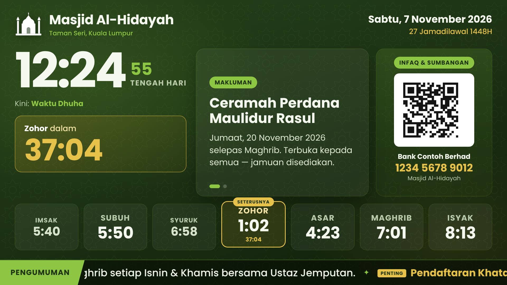
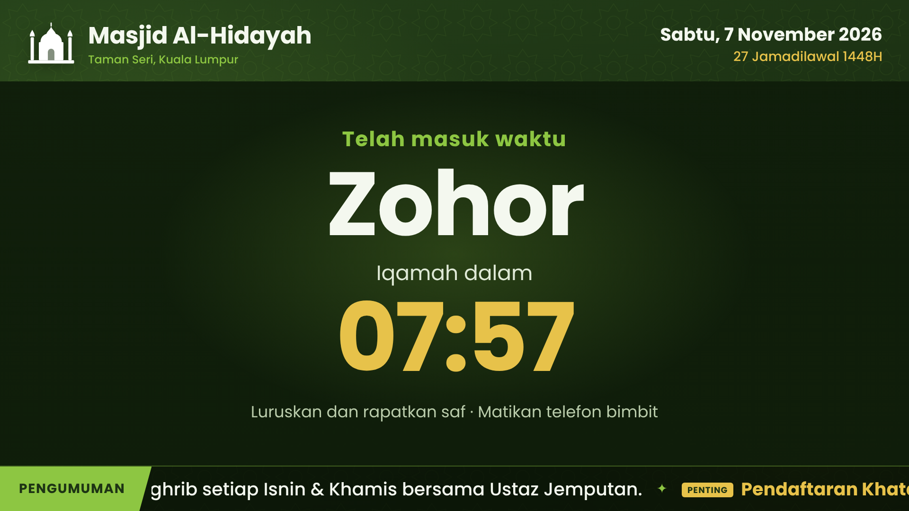
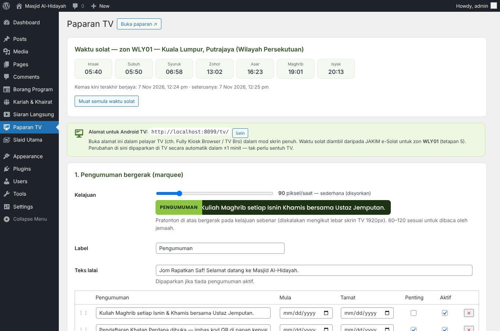
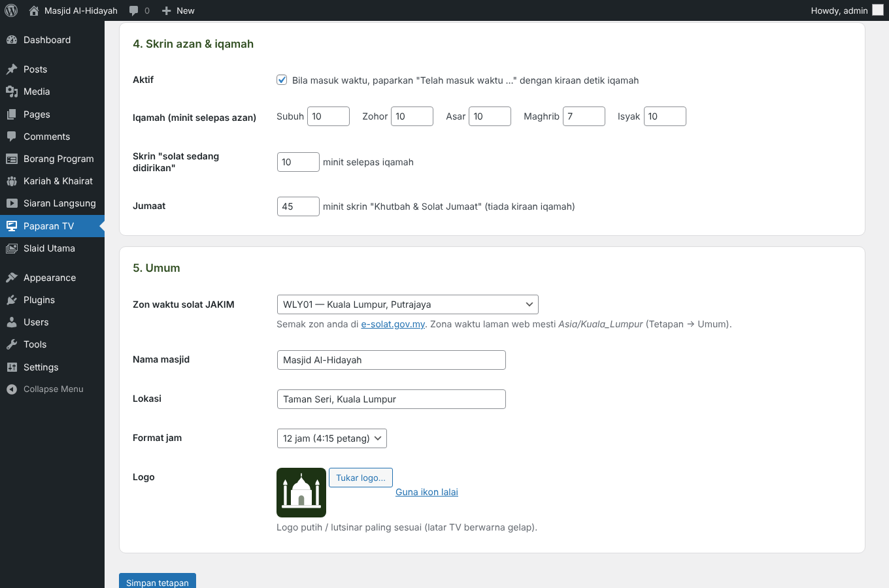

# Paparan TV Masjid

Plugin WordPress yang menjadikan mana-mana **TV pintar / Android TV di masjid atau surau** sebagai papan maklumat digital — cuma buka `https://laman-anda/tv/` dalam pelayar TV. Jam besar, **waktu solat JAKIM** (pilih zon) dengan waktu semasa & seterusnya serta kiraan detik, skrin **azan & iqamah**, slaid makluman, **Infaq** (DuitNow QR + akaun bank) dan pengumuman bergerak. Semua diurus dari wp-admin; TV mengemas kini sendiri.

*A WordPress plugin that turns any smart / Android TV in a Malaysian mosque into a digital signage screen at `/tv/`: large clock, official JAKIM e-Solat prayer times for your zone with current/next prayer and countdown, azan & iqamah countdown screens (Friday khutbah mode), rotating notices, DuitNow QR donation card and a speed-adjustable scrolling ticker — all managed from wp-admin, the TV refreshes itself. UI is in Bahasa Melayu.*

## Ciri-ciri

- **Waktu solat rasmi JAKIM** (e-Solat) untuk zon pilihan anda — Imsak hingga Isyak; waktu semasa diserlah hijau, waktu seterusnya emas dengan kiraan detik (berdenyut 10 minit terakhir); *Waktu Dhuha* selepas Syuruk; selepas Isyak dikira ke Subuh esok; Zohor hari Jumaat dilabel *Jumaat*
- Data disimpan setiap bulan dalam pangkalan data dan dikemas kini 2× sehari (sumber sandaran: api.waktusolat.app) — TV tetap berfungsi walaupun JAKIM tidak dapat dihubungi
- **Skrin azan & iqamah**: "Telah masuk waktu Zohor — Iqamah dalam 07:57" (minit iqamah setiap waktu boleh ditetapkan), kemudian "Solat sedang didirikan"; hari Jumaat — skrin *Khutbah & Solat Jumaat*
- **Slaid makluman** di panel tengah (tajuk + mesej, tarikh mula/tamat)
- **Infaq**: kod QR DuitNow + bank, no. akaun & nama akaun — dalam putaran slaid atau sentiasa dipaparkan
- **Pengumuman bergerak** (marquee) — tarikh mula/tamat, tanda *Penting*, kelajuan boleh dilaras dengan pratonton masa nyata di wp-admin
- Tarikh Masihi & Hijrah (BM), jam 12 atau 24 jam, logo & nama masjid
- Pentas 1920×1080 diskala automatik ke sebarang saiz skrin; jam diselaraskan dengan masa pelayan (jam TV yang salah tidak menjejaskan)
- TV menyemak tetapan setiap minit — perubahan di wp-admin muncul sendiri; muat semula sendiri selepas kemas kini plugin dan setiap pagi 3:30; terus berjalan jika internet terputus (titik merah di penjuru)

| Skrin iqamah | Tetapan — zon, waktu hari ini, pengumuman | Tetapan — azan & umum |
|---|---|---|
|  |  |  |

## Pemasangan

1. Muat turun **`paparan-tv-masjid.zip`** dari halaman [Releases](../../releases/latest).
2. wp-admin → **Plugins → Add New → Upload Plugin** → pilih zip → **Install Now** → **Activate**.
3. **Paparan TV** → pilih **zon waktu solat JAKIM** (bahagian 5), isi nama masjid, logo, akaun bank & kod QR, pengumuman → **Simpan**.
4. Pastikan **Tetapan → Umum → Zon waktu** ialah *Kuala Lumpur* (UTC+8).
5. Pada TV, buka **`https://laman-anda/tv/`** dalam skrin penuh.

### Cadangan untuk Android TV

**Fully Kiosk Browser** (atau TV Bro): tetapkan URL mula ke `/tv/`, *launch on boot*, *keep screen on*, sembunyikan bar sistem. Butang OK pada alat kawalan jauh = skrin penuh.

### Ujian

- `/tv/?uji=13:04` — berpura-pura masa sekarang 1:04 petang (lihat skrin azan/iqamah)
- `/tv/?slaid=2` — mula pada slaid kedua

## Untuk pembangun

| Hook / endpoint | Kegunaan |
|---|---|
| `GET /wp-json/paparan-tv/v1/data` | Data TV (awam, tanpa cache) — waktu solat semalam…lusa, tetapan paparan |
| `ptv_slug` (penapis) | Tukar alamat `/tv/` (cth. `skrin`) — simpan semula Permalinks selepas menukar |
| `ptv_roles` | Peranan yang diberi keupayaan `ptv_urus` (lalai: Administrator, Editor, AJK Kariah) |
| `ptv_github_updates` | `__return_false` untuk mematikan semakan kemas kini GitHub |

## Keperluan

WordPress 6.4+ · PHP 8.1+ · pelayan boleh menghubungi `www.e-solat.gov.my` (atau `api.waktusolat.app`). Fon Poppins dimuatkan dari Google Fonts.

## Menyahpasang

Memadam plugin membuang tetapan dan data waktu solat yang disimpan.

## Berpindah dari binaan khusus (Perepat Paparan TV)

Tetapan dikongsi (`ptv_settings`). Nyahaktifkan plugin lama, aktifkan plugin ini, kemudian pilih zon JAKIM, logo dan kod QR semula (binaan lama mengambil dari tema).

## Lesen

GPL-2.0-or-later © Mohd Nordin Hussain
